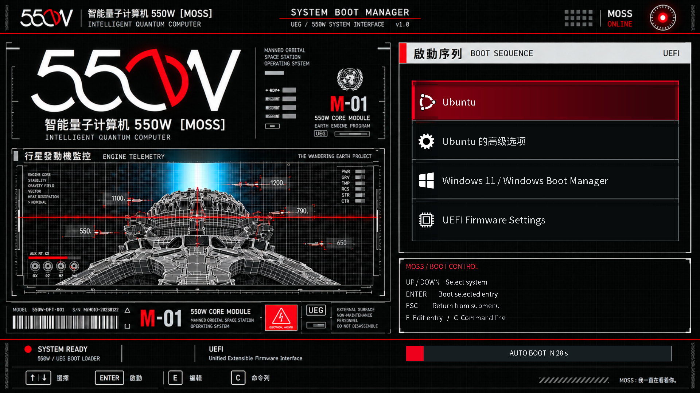

# 550W / MOSS — Ubuntu 与 Windows 11 GRUB 主题

给双系统电脑用的启动菜单主题。菜单和红色选中框由 GRUB 画出来，底部进度条显示剩余秒数。Ubuntu 内核、恢复模式、Windows 入口和默认启动系统都用电脑上原来的配置。



下载：[550w-moss-grub.zip](https://github.com/iskshadow195563/550w-moss-grub/releases/latest/download/550w-moss-grub.zip) · [SHA256 校验文件](https://github.com/iskshadow195563/550w-moss-grub/releases/latest/download/550w-moss-grub.zip.sha256)

## 在 Ubuntu 中安装

1. 重启进入电脑上已装的 Ubuntu，把 `550w-moss-grub.zip` 放到下载目录并解压。
2. 在解压出的 `550w-moss-grub` 文件夹里打开终端：

```bash
bash check.sh
sudo bash install.sh --dry-run
sudo bash install.sh
```

3. 装完重启。要从电脑原来的 Ubuntu / GRUB 入口启动，才会看到这个主题。

默认 1080p，倒计时 8 秒。脚本会重新生成 GRUB 配置并检查，不用另外跑 `update-grub`。字体包内自带，支持英文、常用简繁体汉字和中文标点，安装时不上网下载。

只能装在真实安装的 Ubuntu 上。Windows PowerShell、WSL 和 Live USB 都不行，脚本会直接拒绝；找不到现有 GRUB 配置时也会停。

## 选择分辨率和等待时间

```bash
# 4K 布局，固件要支持 3840×2160 图形模式
sudo bash install.sh --resolution 4k --timeout 8

# 1440p
sudo bash install.sh --resolution 1440p

# 720p 或更低的显示器
sudo bash install.sh --resolution 720p

# 一直等，不自动启动
sudo bash install.sh --timeout -1

# 回到本主题的默认布局
sudo bash install.sh --resolution 1080p --timeout 8
```

支持 `720p`、`1080p`、`1440p`、`4k`。主题按 16:9 做，背景由 GRUB 缩放，其他比例会变形。图形模式由固件给，和 Windows / Ubuntu 桌面分辨率不是一回事。在菜单按 C，输入 `videoinfo` 看支持的模式，按 Esc 返回。

高分辨率用不了时，脚本会退到较低模式和 `auto`。字号跟着布局固定，回退后字太大就用 `1080p` 或 `720p` 重装，或者用下面的安全布局。菜单能滚动，多出来的启动项和子菜单都进得去。

背景：源参考图 3840×2160，存在 `assets/original-reference.png`。清掉动态区域的实际背景是 1672×941，由 GRUB 放大显示。4K 指菜单布局和显示模式，背景不是原生 4K，也不是原图逐像素版。

### 其他电脑只显示一个大图标

在出问题那台电脑的 Ubuntu 里重装，加 `--safe-mode`：

```bash
sudo bash install.sh --safe-mode --dry-run
sudo bash install.sh --safe-mode --timeout 8
```

不用先卸载。安全模式字小、图标 24 像素、行高紧凑，640×480 也能同时看到四个菜单项，更长的还能滚。先试 1024×768，不行退 800×600、640×480。默认系统和启动项保持原样。

安全模式只把当前布局要的字体和一个 14 像素控制台字体装到 `/boot`，并在图形终端初始化前锁住 `gfxterm_font`，这样终端重建时不会换成大字号。`GRUB_FONT` 只决定加载哪个字体文件，管不了 `gfxterm_font`。

安全模式稳定、`videoinfo` 也确认固件支持目标模式，就重跑 `sudo bash install.sh --resolution 1080p` 之类恢复大字号。同一次开机还出问题，先存下 `sudo bash check.sh` 的输出，再在 GRUB 按 C，跑 `videoinfo` 和 `echo $gfxmode`。`$gfxmode` 是要的模式列表，实际模式看 `videoinfo` 里标的当前模式。

测过的环境：Ubuntu GRUB 2.12 的独立虚拟机，正常布局和低分辨率都跑过。用户那台电脑上的偶发突变没复现。

## 使用

| 按键 | 操作 |
| --- | --- |
| ↑ / ↓ | 选启动项，按任意键停掉自动启动倒计时 |
| Enter | 启动，或进入 Ubuntu 高级选项 |
| Esc | 从子菜单返回 |
| E | 编辑选中项，能不能编辑看原有 GRUB 权限 |
| C | 进 GRUB 命令行，能不能进看原有 GRUB 权限 |

主题不固定启动项，也不写死内核版本。菜单的名字、顺序、数量都来自电脑现有配置，可能和截图不一样。Ubuntu 高级选项一般在 Windows 前面，截图里的顺序只是示例。

背景里原来的 Windows / Ubuntu 字样、假诊断状态、`grub>` 光标和「08 秒」都清掉了，右下角改成操作说明。550W 标识、引擎监控图、`SYSTEM READY`、`MOSS ONLINE`、`UEFI` 这些是装饰，不做硬件检测。

## 安装位置与恢复

- `/boot/grub/themes/550w-moss/`：背景、字体、图标和主题。
- `/etc/default/grub.d/zzzz-550w-moss.cfg`：主题、图形输出、显示模式和等待时间。
- `/etc/grub.d/00_550w_moss_font`：在 `00_header` 初始化图形终端前固定小字号控制台字体，卸载时删掉。
- `/var/lib/550w-moss/grub.cfg.before-install`：第一次安装前的 GRUB 配置备份。

只新增上面这几个文件。`/etc/default/grub` 和原有的 `/etc/grub.d/` 脚本不动。分区、Windows EFI 文件、Secure Boot、固件启动顺序、GRUB 默认系统都不碰，`os-prober` 也不会开。原来用串口或纯文本输出的话，本包会把菜单输出切到 `gfxterm`，卸载时改回去。

安装流程：先生成临时 `grub.cfg`，用 `grub-script-check` 检查，再确认原菜单里的 Windows 和 Linux 内核入口还在，最后才替换。出错就还原配置和主题。重复安装保留第一次的备份。目标位置已有不属于本包的文件就停下。

卸载，恢复原来外观：

```bash
sudo bash uninstall.sh
```

卸载按当前内核重新生成菜单，不会把已经删掉的旧内核写回去。第一次的备份留着排查用。安装和卸载共用一把文件锁，不会同时改配置。

## 常见问题

- 装完还是进 Windows：主题只在现有 Ubuntu 的 GRUB 里显示。开机先从固件启动菜单选 Ubuntu。要不要把 Ubuntu 设成默认启动项，是另一件事。
- 菜单里没有 Windows：主题不创建系统入口。先跑 `sudo bash check.sh`。Windows 的 EFI 分区不一定挂在 `/boot/efi`。重新生成菜单会丢掉原有 Windows 入口时，脚本会取消并还原。
- 图形菜单没出来：先试 `sudo bash install.sh --resolution 720p`，再用 `videoinfo` 看固件支持哪些模式。别的 GRUB 片段可能盖掉本包，脚本会检查主题路径有没有进生成的配置。
- 出现方框：字体覆盖 U+4E00–U+9FFF，其他语言和罕见字没有。自定义菜单要用这些字，得自己补 PF2 字体。
- 缺 GRUB 工具：预检查说没有 `grub-mkconfig` / `grub-script-check`，在 Ubuntu 里装 `grub-common` 再试。包不会自己装软件。
- 开机不进菜单：从固件启动菜单直接进 Windows。还能进 Ubuntu 就跑卸载。要用 Live USB 修，先挂好已装的系统再 chroot，按你的分区来。

## 素材与构建

背景用 imagegen 清理，提示词在 `docs/image-edit-prompt.txt`。源图随源码保存，安装 ZIP 只放用得到的文件。

字体从 [Noto Sans CJK](https://github.com/notofonts/noto-cjk) 转成 GRUB PF2，授权是 SIL Open Font License 1.1，全文在 `licenses/Noto-OFL.txt`。图标和九宫格边框由 `scripts/` 生成。

```powershell
# Windows：生成图标、边框和各分辨率布局
powershell -ExecutionPolicy Bypass -File scripts/build-assets.ps1
python scripts/build-themes.py
```

```bash
# Linux：重新生成字体，默认用系统的 Noto CJK
bash scripts/build-fonts.sh

# 构建只含演示菜单的 ISO，用于虚拟机预览
bash scripts/build-preview.sh
```

主题元素和配置变量见 [GNU GRUB 主题格式](https://www.gnu.org/software/grub/manual/grub/html_node/Theme-file-format.html) 和 [GNU GRUB 配置](https://www.gnu.org/software/grub/manual/grub/html_node/Simple-configuration.html)。Ubuntu 生成菜单的机制见 [Ubuntu GRUB 2 Setup](https://help.ubuntu.com/community/Grub2/Setup)。

预览 ISO 里的启动项是占位，不能拿来启动真实的 Windows 或 Ubuntu，安装包用的是你电脑上的配置。验证环境和结果见 `docs/validation.md`。

## 授权

[](LICENSE)

本项目用 MIT 授权，著作权声明是 `Copyright (c) 2026 GGbone (iskshadow195563)`。

MIT 覆盖：`install.sh`、`uninstall.sh`、`check.sh`、`scripts/` 里的构建脚本、`theme/` 里的主题设置和脚本生成的图标、九宫格边框，以及 imagegen 生成的背景图。可以随意使用、修改、再分发、商用，保留 `LICENSE` 里的著作权和授权声明就行。

第三方元件不归 MIT 管：

- 字体：Noto Sans CJK 转出来的 PF2 文件，按 SIL Open Font License 1.1 授权，全文见 [`licenses/Noto-OFL.txt`](licenses/Noto-OFL.txt)。
- GRUB：GNU GPL v3，是电脑上的系统组件，本包不带它。

再分发安装包时，`LICENSE` 和 `licenses/Noto-OFL.txt` 都要留着，两个文件都在 ZIP 里。
